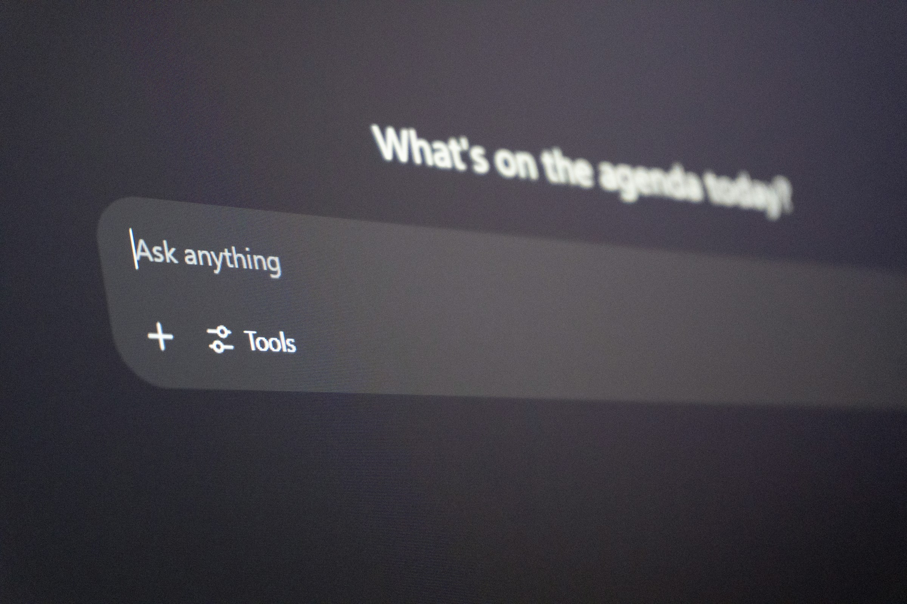

Para agregar funciones de IA a un producto SaaS, parte de una tarea que tus usuarios ya hacen lento (encontrar algo, escribir algo o ponerse al día con algo) y elige la función que le corresponde: búsqueda con IA para encontrar, un copiloto para escribir y hacer, resúmenes para ponerse al día. Conecta el modelo a los datos de tu propio producto, pruébalo contra ejemplos reales antes de cada versión y diseña la pantalla para que la gente pueda revisar, editar o deshacer lo que produjo la IA. Lánzalo detrás de un feature flag para unas pocas cuentas, mide si la gente lo sigue usando y recién ahí amplíalo.

La mayoría de los equipos lo hace al revés. Alguien pone una burbuja de chat en una esquina de la app, el uso se dispara una semana y después cae casi a cero. El modelo estaba bien. La función no estaba atada a ninguna tarea.

## ¿Para quién es esta guía?

Para founders, líderes de producto y líderes de ingeniería de empresas B2B SaaS con un producto que funciona y clientes que pagan, que ahora enfrentan la pregunta que aparece en cada directorio y cada llamada de ventas: ¿dónde está la IA? Si la IA es todo el producto y empiezas de cero, lee primero nuestra guía sobre [cómo construir un MVP de IA](/es/blog/como-construir-un-mvp-de-ia/). Esta pieza es para sumar IA a algo que ya funciona.

## ¿Qué función de IA conviene agregar primero?

Los copilotos, la búsqueda con IA y los resúmenes resuelven problemas distintos, necesitan datos distintos y fallan de maneras distintas. Elige según la tarea, no según lo que lanzó un competidor el mes pasado.

| | Búsqueda con IA | Resúmenes | Copiloto | Agente |
| --- | --- | --- | --- | --- |
| Qué hace | Encuentra el registro o la respuesta correcta | Pone al día sin leer todo | Redacta o completa algo junto al usuario | Ejecuta una tarea de varios pasos por su cuenta |
| Mejor cuando | Los usuarios bucean en docs, tickets o logs | Hay hilos, reportes o feeds de actividad largos | La escritura o la configuración es repetitiva | Los pasos son conocidos y de bajo riesgo |
| Datos que necesita | Contenido indexado con permisos | El texto a resumir | Contexto de la pantalla y del usuario | Acceso a herramientas y reglas para cada acción |
| Costo de un error | Bajo si se muestra la fuente | Medio: los detalles omitidos parecen ciertos | Bajo: el usuario edita antes de usarlo | Alto: las acciones llegan a sistemas reales |
| El UX que más importa | Fuentes y filtros | Enlaces al original | Editar, aceptar y rechazar fácil | Aprobaciones, progreso y deshacer |

En la mayoría de los productos B2B, la búsqueda con IA o los resúmenes son la apuesta más segura para empezar. Las dos responden con tus propios datos, las dos muestran sus fuentes y un error cuesta un clic. Los copilotos vienen después. Los agentes, al final, cuando ya confías en las piezas de abajo.

## ¿Cómo encuentras la tarea correcta para la IA en tu producto?

Busca trabajo que tus usuarios ya odian, no lugares para lucir un modelo.

1. **Lista los cinco flujos más frecuentes** a partir de tu analítica y de los tickets de soporte.
2. **Marca dónde la gente lee, escribe o busca** durante más de un minuto. Esos son candidatos para la IA. Hacer clic en una página de configuración no lo es.
3. **Pregúntate cuánto cuesta un error** en cada lugar. Un mal resumen de un hilo de soporte es barato. Un número equivocado en una factura, no.
4. **Junta entre 30 y 50 ejemplos reales** de la entrada y de la salida que produciría una buena persona. Ese es tu primer conjunto de evaluación.
5. **Elige uno.** Un flujo, un rol de usuario, una función. La segunda puede esperar a que la primera demuestre que se usa.

Un ejemplo corto. Una plataforma de DevOps escucha que los ingenieros de guardia pierden los primeros diez minutos de cada incidente leyendo alertas y logs. La respuesta no es un chatbot. Es un resumen arriba de la página del incidente: qué se disparó, qué cambió en el último deploy, qué servicios están afectados, cada línea enlazada a su fuente. Mismo modelo, muchas más chances de que la gente lo use todos los días.

## ¿Cómo diseñas un copiloto de IA que la gente realmente use?

Un copiloto funciona cuando vive dentro del flujo, no al costado. Pon la sugerencia donde el usuario ya está escribiendo o decidiendo: una respuesta redactada en la caja de respuesta, una regla sugerida en el editor de reglas, un campo precompletado en el formulario.

Una caja vacía de "pregunta lo que quieras" le deja todo el trabajo al usuario, que tiene que adivinar qué puede hacer la IA. Los mejores copilotos:

- **Parten del contexto.** Ya conocen la cuenta, el registro y la pantalla, así que el usuario no tiene que explicar nada.
- **Ofrecen acciones concretas** ("Redactar una respuesta", "Explicar este error", "Sugerir una solución") en lugar de un prompt vacío.
- **Hacen que editar sea más fácil que rechazar.** El resultado llega como un borrador editable, nunca como una acción terminada.
- **Recuerdan el feedback.** Un pulgar abajo con un motivo va directo a tu conjunto de evaluación.

Repasamos los patrones de fondo en nuestra guía de [diseño de producto AI-first](/ai-first-product-design/) (en inglés).

## ¿Qué hace que la búsqueda con IA funcione dentro de un producto B2B?

Recuperación, permisos y fuentes, en ese orden. La búsqueda con IA (muchas veces construida con generación aumentada por recuperación, o RAG) encuentra las partes relevantes de tu contenido y hace que el modelo responda a partir de ellas. Si la recuperación trae el documento equivocado, la respuesta va a estar equivocada con total seguridad, así que prueba la recuperación por separado antes de culpar al modelo.

Los permisos son la parte que los equipos olvidan. Si un usuario no puede abrir un registro en tu producto, la búsqueda con IA nunca debe citarlo. Filtra los resultados con las mismas reglas de acceso que tu app ya aplica, antes de que algo llegue al modelo. Después muestra las fuentes junto a cada respuesta, para que revisar tome un clic.

## ¿Cómo haces que los resúmenes con IA sean confiables?

Enlaza cada afirmación a su origen y di qué dejó afuera el resumen. Un resumen de un hilo de 60 mensajes debería apuntar a los mensajes detrás de cada línea y marcar las preguntas abiertas en lugar de disimularlas. Muestra cuándo se generó, para que nadie actúe sobre un resumen del estado de ayer. Nuestro artículo sobre [UX de IA explicable](/explainable-ai-ux/) (en inglés) profundiza en cómo mostrar el razonamiento sin abrumar al usuario.

## ¿Cuándo necesita una función de IA aprobación humana?

Cuando la IA pasa de sugerir a hacer. Los borradores, las búsquedas y los resúmenes pueden correr libres porque una persona decide qué pasa después. Cuando una función envía, borra, paga, publica o cambia muchos registros a la vez, suma un paso de aprobación con la acción exacta y los números frente al usuario. Nuestra guía sobre [flujos de aprobación human-in-the-loop para agentes de IA](/es/blog/ux-agentes-ia-human-in-the-loop/) ordena las acciones según qué tan reversibles son y a cuánto afectan, para que agregues fricción solo donde vale la pena.

## ¿Cómo lanzas y mides una función de IA?

Trátala como cualquier lanzamiento riesgoso, con una capa extra: la evaluación.

1. **Corre tu conjunto de ejemplos** en cada cambio de prompt, modelo o recuperación, y frena la versión si la calidad baja.
2. **Lánzala detrás de un feature flag** primero para un puñado de cuentas de confianza.
3. **Registra entradas y salidas** con un plazo de retención, para poder depurar fallas reales.
4. **Mide el uso, no las demos:** cuántas veces la gente acepta una sugerencia, cuánto la edita, si la tarea se vuelve más rápida y si vuelve a la función en la cuarta semana.
5. **Vigila el costo por solicitud.** El contexto largo y los prompts extensos se acumulan a medida que crece el uso.

## ¿Conviene diseñar funciones de IA con tu equipo o con una agencia?

Hazlo internamente cuando tienes diseñadores e ingenieros que ya lanzaron funciones de IA y el roadmap es largo. Suma un socio especializado cuando necesitas la primera función en producción este trimestre, tu equipo de diseño nunca trabajó con patrones de interacción con IA, o quieres una mirada externa sobre qué tarea elegir antes de comprometer ingenieros. Si buscas una agencia para mejorar la experiencia de usuario de un producto SaaS B2B y sumarle IA, conviene que el mismo equipo piense el UX y la evaluación.

delbueno™ Studio diseña y construye funciones de IA para equipos B2B SaaS de Cloud, DevOps, Ciberseguridad, IA y Fintech, con el UX, la evaluación y el código decididos por un solo equipo. Nuestro [servicio de desarrollo con IA](/es/servicios/desarrollo-con-ia/) explica cómo trabajamos. Si quieres una segunda opinión sobre dónde encaja la IA en tu producto, [agenda una llamada](/es/contacto/) y te diremos con honestidad qué construir primero, o si todavía no conviene construir nada.

## Preguntas frecuentes

### ¿Cuál es la función de IA más fácil de agregar a un producto SaaS?

Por lo general, los resúmenes o la búsqueda con IA sobre contenido que ya tienes, como tickets, documentación o logs de actividad. Las dos usan tus datos existentes, las dos pueden mostrar sus fuentes y un error es fácil de detectar e ignorar.

### ¿Qué diferencia hay entre un copiloto de IA y un agente de IA?

Un copiloto trabaja con el usuario y le devuelve un borrador o una sugerencia que la persona acepta, edita o rechaza. Un agente da pasos por su cuenta hacia un objetivo, muchas veces usando otros sistemas. Los agentes necesitan aprobaciones, vistas de progreso y opción de deshacer, porque sus acciones tienen efectos fuera de la pantalla.

### ¿Necesito RAG para agregar búsqueda con IA a mi producto?

En la mayoría de los productos B2B, sí. La recuperación permite que el modelo responda con tu contenido actual en lugar de con lo que recuerda, que respete los permisos de cada usuario y que muestre una fuente para cada respuesta. Sin eso, las respuestas se desactualizan y no se pueden verificar.

### ¿Cómo sé si los usuarios de verdad valoran una función de IA?

Mira más allá de los clics de la primera semana. Mide cuántas sugerencias se aceptan, cuánto se editan, si la tarea se vuelve más rápida y si la gente sigue usando la función un mes después. Si el uso se apaga cuando pasa la novedad, la función todavía no está atada a una tarea real.

*Fotos de Carlos Muza y Zulfugar Karimov en Unsplash.*
