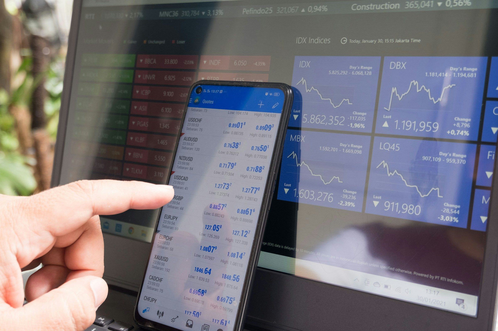

La mejor agencia de diseño UX para una startup fintech es la que ya entregó movimientos de dinero, verificación de identidad y dashboards financieros, y que encaja con tu etapa y tu presupuesto. Para una fintech en etapa seed, eso suele significar un equipo senior de diseño de producto que trabaje rápido, sepa convivir con las revisiones de compliance y tenga un caso fintech que puedas abrir y revisar. Las firmas que vale la pena comparar en 2026 incluyen UXDA, Clay, MetaLab, Ramotion, Fuzzy Math, Eleken y delbueno™ Studio, cada una ideal para una situación distinta.

**Aviso:** este artículo lo escribe delbueno™ Studio, que es una de las agencias de la lista. Nadie pagó por aparecer y no hay enlaces de afiliados. Cada dato sobre las otras agencias sale de sus propios sitios web o perfiles públicos, revisados en noviembre de 2026. Si algo cambió, avísanos y lo corregimos.

## ¿Para quién es esta guía?

Para founders, responsables de producto y líderes de ingeniería en startups fintech, desde pre-seed hasta Serie A: pagos, bancos digitales, préstamos, apps de inversión, herramientas financieras para empresas y la infraestructura que hay detrás. Estás decidiendo si sumar un socio de diseño externo y quieres una lista corta que puedas verificar.

No está pensada para bancos en medio de una transformación digital de varios años, aunque dos agencias de la lista hacen ese trabajo. Para ver el panorama completo, lee nuestra [guía de diseño UX para startups](/es/blog/diseno-ux-para-startups/).

## ¿Qué tiene de distinto el diseño UX para startups fintech?

Tres cosas que un socio de diseño fintech debería sacar en la primera llamada:

1. **El dinero se mueve en una sola dirección.** Una transferencia, una operación o una cuenta cerrada muchas veces no se pueden deshacer, así que las confirmaciones, las vistas previas y las ventanas de recuperación pesan de verdad. Lo explicamos en [UX para fintech: acciones que el usuario no puede deshacer](/es/blog/ux-fintech-acciones-irreversibles/).
2. **El compliance vive dentro del producto.** La verificación de identidad y los avisos legales son donde los usuarios nuevos abandonan, así que ordenarlos bien es trabajo de onboarding (mira los [patrones de UX para el onboarding SaaS](/es/blog/onboarding-saas-patrones-ux/)).
3. **La confianza se gana en los detalles.** Números claros, errores escritos en lenguaje simple, roles que limitan quién puede mover dinero ([UX de permisos RBAC que la gente entiende](/es/blog/diseno-ux-permisos-rbac/)) y textos que ya aprobó el área legal.

## ¿Qué trabajo de UX fintech importa en cada etapa?

| Etapa | Tarea principal de UX fintech | Dónde rinde la ayuda externa |
| --- | --- | --- |
| Pre-seed | Probar un flujo de dinero en el que la gente confíe | Un prototipo navegable del flujo principal para tests con usuarios e inversores |
| Seed | Llevar a los usuarios verificados a su primera transacción | Onboarding y verificación, flujos de pago y transferencia, el dashboard principal |
| Serie A | Escalar el producto y el equipo | Design system, roles y aprobaciones, reportes para equipos de finanzas |

Los productos regulados tardan más en diseñarse porque las revisiones legales suman rondas. En [cuánto tiempo lleva diseñar un MVP SaaS](/es/blog/cuanto-tiempo-lleva-disenar-un-mvp-saas/) contamos dónde se va ese tiempo.

## ¿Cómo elegimos las agencias de esta lista?

Una agencia entró en la lista solo si cumplía los cuatro criterios:

1. **El diseño de producto es un servicio central**, no un extra del marketing o el desarrollo.
2. **Trabajo público en fintech o servicios financieros**, en casos de estudio o clientes nombrados en su propio sitio o en una fuente confiable.
3. **Toma proyectos de startups o scale-ups**, o aclaramos cuándo su cliente típico es una institución grande.
4. **Datos que pudimos verificar** en el sitio de la agencia o en un perfil público.

No es un ranking. Cada agencia tiene una etiqueta de "ideal para" basada en lo que destaca públicamente.

## ¿Qué firmas de diseño fintech vale la pena comparar para un producto nuevo?

| Agencia | Sede | Ideal para | Trabajo fintech público, por ejemplo |
| --- | --- | --- | --- |
| UXDA | Riga, Letonia | Bancos e instituciones financieras consolidadas | Emirates NBD, HSBC, GCash, Finastra |
| Clay | San Francisco, EE. UU. | Marca y producto fintech con un solo equipo | Stripe, Coinbase, Marqeta, Tipalti |
| MetaLab | Victoria y Vancouver, Canadá | Fintechs con buen financiamiento que quieren un equipo de producto consolidado | Coinbase |
| Ramotion | San Francisco, Los Ángeles y Nueva York, EE. UU. | Lanzamientos fintech donde la marca pesa mucho | Stripe, Truebill, Wyre, Puzzle |
| Fuzzy Math | Chicago, EE. UU. y Toronto, Canadá | Modernizar software financiero empresarial | KPMG, Northern Trust, Allstate |
| Eleken | Kiev, Ucrania | Fintechs B2B SaaS que quieren un diseñador integrado con plan mensual | PayUp, Cylynx |
| delbueno™ Studio | Punta del Este, Uruguay (horario de EE. UU.) | MVPs fintech en etapa seed, diseñados y construidos por un mismo equipo | Buzz Bunny |

## ¿Qué agencias de diseño de producto son las mejores para fintech, y por qué?

### UXDA: ideal para bancos e instituciones financieras consolidadas

UXDA trabaja solo en finanzas y se presenta como "Strategic UX Design Partner for Fintech & Banking Products". Su [sitio](https://theuxda.com/) menciona oficinas en Riga, Nueva York y Londres, más de 150 sistemas de servicios financieros diseñados y clientes en 39 países. Sus casos de estudio indican proyectos estratégicos desde €350,000, así que su cliente típico es un banco más que una startup en etapa seed.

### Clay: ideal para marca y producto fintech con un solo equipo

Clay es una agencia de branding y UX fundada en San Francisco. Su [página de fintech](https://clay.global/fintech) muestra entre sus clientes a Stripe, Coinbase, Credit Karma, Marqeta, Tipalti y MoneyLion. Encaja cuando la marca, el sitio y la app tienen que salir de un mismo equipo.

### MetaLab: ideal para fintechs con buen financiamiento que quieren un equipo consolidado

MetaLab es una firma de diseño de interfaces fundada en 2006 en Columbia Británica. Su [entrada en Wikipedia](https://en.wikipedia.org/wiki/MetaLab,_Ltd.) dice que trabaja con empresas de software de sectores como fintech y menciona a Coinbase entre sus clientes. Más en [metalab.com](https://www.metalab.com/).

### Ramotion: ideal para lanzamientos fintech donde la marca pesa mucho

Ramotion es una agencia de diseño de producto y marca con sedes en San Francisco, Los Ángeles y Nueva York. Su [portafolio fintech](https://www.ramotion.com/work/fintech/) incluye trabajo para Stripe, Truebill, Wyre y Puzzle, y prototipado rápido de interfaces para Xero.

### Fuzzy Math: ideal para modernizar software financiero empresarial

Fuzzy Math es una consultora de UX de Chicago y Toronto que trabaja desde 2009 en software B2B y empresarial. Su [página de servicios financieros](https://fuzzymath.com/work/fintech-financial-services-ux-design/) nombra a KPMG, Northern Trust, Allstate y Wolters Kluwer CCH.

### Eleken: ideal para fintechs B2B SaaS que quieren un diseñador integrado

Eleken es una agencia de UI/UX para productos SaaS con oficina en Kiev, que trabaja con un modelo de suscripción. Su [artículo sobre fintech](https://www.eleken.co/blog-posts/fintech-design-agency) cuenta cómo llevó a PayUp de un MVP a un producto escalable, con un solo design system para web y móvil.

### delbueno™ Studio: ideal para MVPs fintech diseñados y construidos por un mismo equipo

delbueno™ Studio, autor de este artículo, es un estudio de diseño de producto y desarrollo con IA en Punta del Este, Uruguay, que trabaja en horario de EE. UU. Para [Buzz Bunny](/es/trabajo/buzz-bunny/), una app de recomendaciones de acciones con IA, hicimos la investigación, el design system y el desarrollo en Flutter, y la finalización del onboarding pasó del 62% al 91% a lo largo de las rondas de prueba. El equipo también trabajó con BigID, JFrog, NetApp y Palo Alto Networks en interfaces B2B densas. El kickoff es el mismo día en que se acuerda el alcance y los primeros conceptos llegan en 48 horas. Más sobre nuestro [trabajo de UX fintech](/es/industrias/fintech/).

## ¿A quién contratar para diseñar un producto fintech bien resuelto?

1. **Nombra tu pantalla más riesgosa.** Una primera transferencia a un destinatario nuevo, una verificación de identidad, la confirmación de una operación. Pide a cada agencia que te muestre lo más parecido que haya entregado.
2. **Pregunta cómo trabaja con compliance.** Quién escribe los textos, cómo se incorporan los comentarios del área legal y cómo se documentan las decisiones.
3. **Revisa el ritmo.** Superposición horaria, quién hace el trabajo día a día y qué tan rápido llega el primer entregable.
4. **Haz una prueba pagada chica** sobre un flujo real antes de firmar algo grande.

Si buscas una agencia de UX/UI B2B en general, mira [las mejores agencias de diseño UX para startups B2B SaaS](/es/blog/mejores-agencias-diseno-ux-b2b-saas/). Si prefieres un socio en tu zona horaria, mira [las mejores agencias de UX y diseño de producto en Latinoamérica](/es/blog/mejores-agencias-ux-diseno-producto-latinoamerica/). Los criterios y las señales de alerta están en [cómo elegir una agencia de diseño UX](/how-to-choose-ux-design-agency-saas/) (en inglés).

## ¿Cuál es el siguiente paso?

Si estás evaluando entre un diseñador interno y un socio especializado para un producto fintech, [habla con nosotros](/es/contacto/). Te diremos con honestidad si otra agencia de esta lista encaja mejor. Si primero quieres una mirada externa de tu producto actual, pide una [auditoría de UX gratis](/es/auditoria-ux-gratis/).

## Preguntas frecuentes

### ¿Una startup fintech necesita una agencia especializada en fintech?

No siempre, pero la agencia tiene que haber entregado antes movimientos de dinero, verificación o dashboards financieros. Pide un caso fintech que puedas abrir, no solo logos.

### ¿Qué debería entregar una agencia de UX fintech para un MVP en etapa seed?

El flujo principal de dinero, el onboarding con verificación, el dashboard principal y todos los estados vacíos, de carga y de error, más una pequeña librería de componentes con la que ingeniería pueda construir. El pulido de marca y un design system completo pueden esperar.

### ¿Esta lista es un ranking?

No. Cada agencia tiene una etiqueta de "ideal para" basada en lo que destaca públicamente. delbueno™ Studio, que escribió el artículo, es una entrada entre siete.

### ¿Una agencia de diseño puede trabajar con requisitos de compliance?

Sí, si compliance participa desde el principio. Comparte tus restricciones regulatorias en el kickoff, acuerda quién aprueba los textos y pide a la agencia que documente el porqué de cada paso de verificación y confirmación.

### ¿Una agencia de diseño fintech firma un NDA?

La mayoría lo hace si se lo pides. delbueno™ Studio firma NDAs a pedido, así que pregunta antes de compartir algo sensible.

*Fotos de Atlantic Money y Marga Santoso en Unsplash.*
