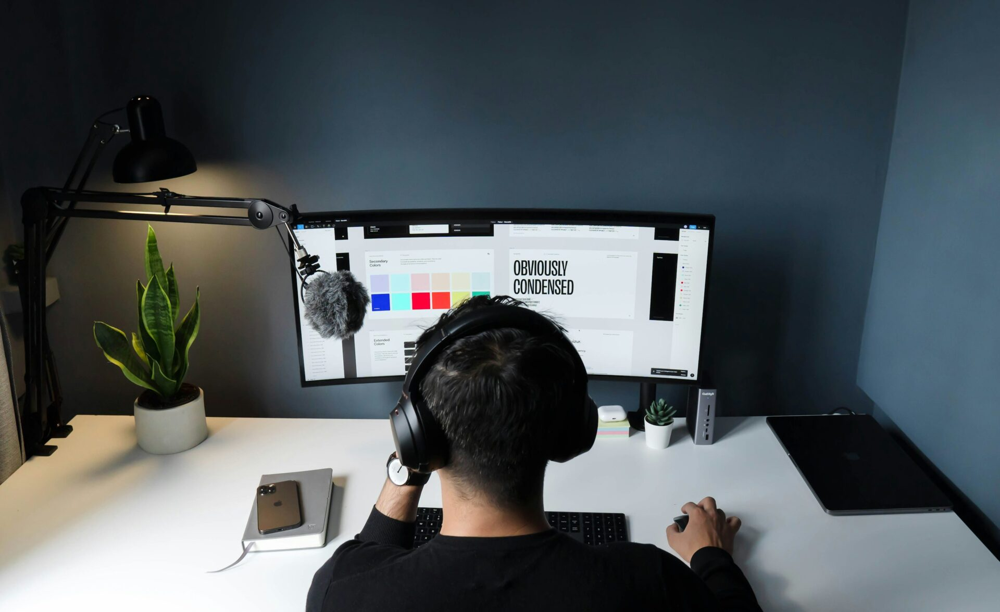

Teams do their best work when they reduce blank screens and long reviews. Modern **AI design tools** turn an empty canvas into a solid first draft, help create variants in minutes, and translate flows into clear states that engineering can ship. This guide shows how to apply **AI for product designers** in ways that save time while protecting craft. You will see where **generative UX** creates options worth keeping, how **AI prototyping** validates ideas early, and which governance habits keep quality high.

Video: [How I use AI to design faster (my complete workflow)](https://www.youtube.com/watch?v=ni19lPH_wy0)

## **Where AI for product designers delivers real value**

The goal is to move faster without losing coherence. Focus on repetitive tasks and early exploration. Let models handle volume so designers spend energy on structure, meaning, and voice.

### **Create first pass content for states**

Empty, loading, success, and error appear in every flow. Use **AI design tools** to draft concise copy that matches tone. Review for clarity and domain language. Save approved patterns in a system so variants stay consistent.

### **Generate table and form variants**

From a single flow map, ask the tool to propose table layouts and form rules. Include validation hints and helper text. This is a strong early use of **generative UX** because it converts structure into usable screens quickly.

### **Explore alternatives without heavy setup**

When exploring layouts or flows, generate three options that follow the same constraints. Keep the frame and components fixed. Only allow changes to order and emphasis. This preserves intent while giving fresh angles.

## **AI prototyping that answers real questions**

Prototypes exist to reduce risk. Use **AI prototyping** to produce clickable flows that teach you whether people can reach a confident decision quickly.

### **Build only what you need to learn**

If scope selection confuses users, generate the selector states plus the first results screen. If onboarding overwhelms, generate a start here view with a guided path. Keep the prototype tight and focused on the riskiest question.

### **Test fast with real data**

Recruit three target users for short sessions. Ask for first click and first confident decision. Capture time to each and count wrong turns. This keeps **AI prototyping** anchored to outcomes rather than novelty.

## **Collaboration and handoff that stay in sync**

Design moves faster when everyone can read intent and limits in a shared language.

### **Translate flows into acceptance criteria**

Use **AI design tools** to turn a flow map into crisp acceptance tests. Include states, field rules, and edge cases. Engineers get fewer surprises and reviewers can check work against a visible checklist.

### **Convert mocks into developer ready specs**

Ask the tool to extract tokens, spacing, and component names from the current system. Provide a short glossary so names match code. This is a reliable way to raise **AI for product designers** from mock output to implementation support.

## **Guardrails that keep quality high**

Speed must not come at the cost of trust. Adopt light governance that protects tone, coherence, and accessibility.

### **Keep a reviewed pattern library**

When **generative UX** produces a strong variant, add it to the library with usage notes. When a variant fails, capture why so the team avoids repeating the same path.

### **Lock language to domain terms**

Create a short dictionary of product terms and preferred phrasing. Feed it into prompts so **AI design tools** write in the voice customers expect.

### **Run a quick clarity check before shipping**

Use a simple script to read screens aloud and flag long sentences, unclear labels, and inconsistent units. Fix issues before handoff. Quality rises and review cycles shrink.

## **Prompts that produce better results**

Good prompts are precise and local. They name the user, the job, the tone, and the constraints.

### **Sample prompt for state copy**

You are a product writer for a platform team. Write four short strings for empty, loading, success, and error. Use calm voice and domain terms from this list. Keep each under twelve words. Include one example with realistic data.

### **Sample prompt for table design**

You are a designer creating a service table for platform engineers. Propose three column sets that cover environment, status, owner, and last change. Include sorting and compact density. Output in a simple table description.

## **Metrics that show the payoff**

Leaders will ask how the new workflow helps. Share numbers that reflect speed and quality together.

First prototype time from idea.
Time from tested prototype to build behind a flag.
Support volume tied to onboarding and navigation.
First run success and time to first meaningful action.
Reviewer comments per release on copy, labels, and units.

When these move in the right direction, the value of **AI design tools** becomes obvious.

## **A short scenario from practice**

A data platform team needed to overhaul onboarding while shipping features. They used **AI for product designers** to generate first pass states and a compact guided path. They used **AI prototyping** to test the path with three customers in one week. Findings became tickets with acceptance tests created by **AI design tools**. The next cohort reached value faster and tickets about scope confusion fell. The team kept the habit because it saved time without lowering standards. That is the promise of **generative UX** used with intention.

## **Implementation checklist you can start this month**

Pick one journey that has high toil or confusion.
Create a small dictionary of product terms and tone.
Use **AI design tools** to draft states and table variants.
Build a focused **AI prototyping** flow for the riskiest question.
Test with three target users using realistic data.
Turn findings into tickets with acceptance criteria.
Add successful patterns to the library and repeat next sprint.

## **Final take**

The best tools do not replace judgment. They remove repetitive work so you can apply judgment where it matters. With a few guardrails and tight loops, **AI design tools** lift exploration, **AI for product designers** improves handoff, **generative UX** creates useful options, and **AI prototyping** proves direction early. The result is a calm, fast workflow that partners well with engineering.

**Also Read:** The Business Advantage: Why Accessibility Should be at the Core of Your Website Design Strategy
