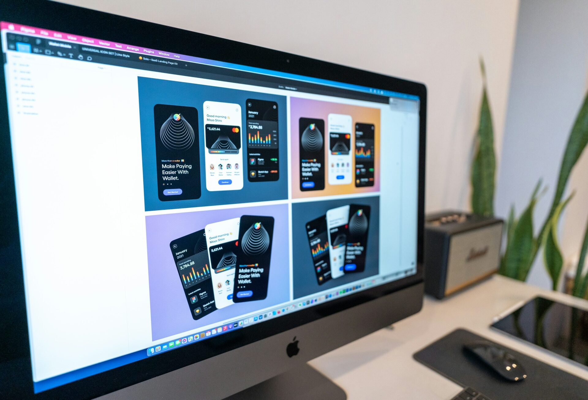

Products feel intelligent when they shorten the path from signal to decision without surprise. That outcome does not happen by accident. It comes from **AI first product design** that treats intelligence as a core interaction material rather than an add on feature. This guide shows how to choose **AI product UX patterns**, structure **ML interface design**, and ship **UX for intelligent software** that experts can trust in real work.

## **What makes a product truly AI first**

An AI first product starts by asking which decisions deserve assistance and which actions deserve safe automation. It avoids novelty for its own sake. It focuses on clarity, reversibility, and learning in place. With **AI first product design**, the goal is not to hide complexity but to reveal only what matters at each moment so people act with confidence.

## **Principles that anchor AI first product design**

Begin with intent. Every suggestion must answer a named job and improve time to decision. Keep explanations close to the control that will execute the action. Make every assisted step reversible. Show what the system looked at, how sure it is, and what will change if the user accepts the suggestion. These simple rules keep **UX for intelligent software** legible under pressure.

## **Core AI product UX patterns that scale**

### **Progressive autonomy with visible control**

Start with guidance, then confirmation, then optional auto apply under clear guardrails. Let users set limits, schedules, and review checkpoints. This pattern respects expertise and keeps **AI first product design** safe in sensitive flows.

### **Human override that is easy to use**

Every assisted decision needs an obvious escape hatch. Provide undo and rollback that explains impact in plain language. When override is smooth, **UX for intelligent software** earns trust during mistakes and edge cases.

### **Confidence UX that explains why**

Pair a concise confidence range with a plain language rationale. Offer nearby alternatives rather than a single path. This is the heart of **ML interface design** for experts who want to verify before they act.

### **Data UX that teaches while you work**

Show the top signals that shaped the suggestion. Let users correct labels or rank outcomes without leaving the task. Record those edits and say when they will influence future results. This turns **ML interface design** into a visible learning loop.

### **Result previews before commitment**

Before anything changes in the real system, show the proposed effect using current scope and permissions. Clear previews make **AI product UX patterns** feel dependable and reduce the need for support.

## **Onboarding for intelligence without confusion**

New users do not need algorithm talk. They need a straight path to one meaningful success. Seed realistic sample data, present one guided flow, and explain how suggestions are formed at a high level. As people return, unfold depth on demand. This measured approach keeps **AI first product design** friendly to beginners and fast for experts.

## **Writing for UX for intelligent software**

Use the language customers use. Name objects and actions as they do. Avoid jargon that blurs meaning. Keep sentences short. In error states, explain what happened, why it likely happened, and what to do next. In success states, confirm what changed and where to verify it. Consistent voice is as important to trust as any model metric.

## **Validating AI product UX patterns without slowing delivery**

Run short task based sessions with three to five target users. Measure time to first click and time to a confident decision with assistance and without assistance. Track acceptance rate, corrections, and rollback rate. Share a one page readout with clips and translate findings into small tickets. This rhythm keeps **AI first product design** aligned to outcomes instead of opinions.

## **Metrics leaders can read at a glance**

Leaders want proof that intelligence helps. Report first run success, accepted suggestion rate, time to decision, and support volume tied to misunderstanding. Update two weeks after each release that changes assisted flows. When these numbers improve, **UX for intelligent software** becomes a visible growth lever.

## **A short scenario from practice**

A release management tool added assisted rollback suggestions based on commit metadata and recent incidents. The team used previews, confidence ranges, and an always available override. They surfaced the top signals that informed each suggestion and let engineers correct the rationale in place. Within a month, time to decision during incidents dropped and trust rose because the system explained itself. That is **AI first product design** working as intended.

## **Implementation plan you can start this month**

Pick one journey with high toil or high risk. Map the user questions and the points where help would remove steps. Add suggestions with previews and confidence. Add undo and rollback with simple language. Record inputs and outcomes for each assisted action. Test with a handful of users and convert findings into small changes. Repeat for the next journey. If the product does not exist yet, start with our guide on [how to build an AI MVP](/how-to-build-an-ai-mvp/). With each cycle, **ML interface design** improves and your **AI product UX patterns** become a stable system.

## **Final take and next step**

Intelligence should feel like a calm partner. When you ground choices in previews, explanations, and easy reversal, people move faster and feel safer. Treat these ideas as product rules, not one time features. If you want a rapid starter plan, we can map your first assisted journey and ship improvements that prove **AI first product design** in production within a single release.

**Also Read:** The Business Advantage: Why Accessibility Should be at the Core of Your Website Design Strategy
