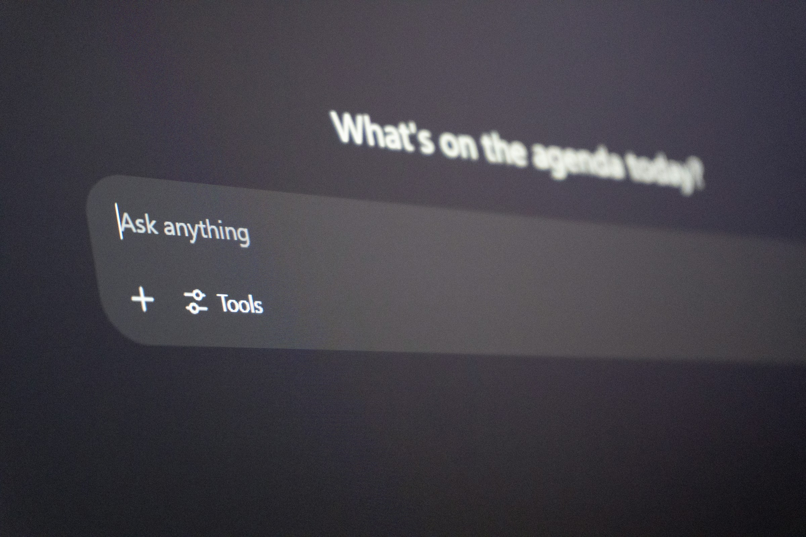

To add AI features to a SaaS product, start from one job your users already do slowly (finding something, writing something, or catching up on something) and pick the feature that fits it: AI search for finding, a copilot for writing and doing, summaries for catching up. Ground the model in your own product data, test it against real examples before every release, and design the screen so people can check, edit or undo what the AI produced. Ship it behind a flag to a few accounts, measure whether people keep using it, and only then expand.

Most teams do it the other way around. Someone adds a chat bubble to the corner of the app, usage spikes for a week, then drops to almost nothing. The model was fine. The feature was not attached to any job.

## Who is this guide for?

Founders, product leaders and engineering leads at B2B SaaS companies with a working product and paying customers, who now face the question every board and sales call is asking: where is the AI? If AI is the whole product and you are starting from zero, read our guide on [how to build an AI MVP](/how-to-build-an-ai-mvp/) first. This piece is for adding AI to something that already works.

## Which AI feature should you add first?

Copilots, AI search and summaries solve different problems, need different data and fail in different ways. Choose by the job, not by what a competitor shipped last month.

| | AI search | Summaries | Copilot | Agent |
| --- | --- | --- | --- | --- |
| Job it does | Find the right record or answer | Catch up without reading everything | Draft or fill something in with the user | Run a multi-step task on its own |
| Best when | Users dig through docs, tickets or logs | Long threads, reports or activity feeds | Repetitive writing or configuration | The steps are known and low risk |
| Data it needs | Indexed content with permissions | The text being summarized | Context about the current screen and user | Tool access plus rules for each action |
| Cost of a wrong answer | Low if the source is shown | Medium: missed details look true | Low: the user edits before using it | High: actions land in real systems |
| UX that matters most | Sources and filters | Links back to the original | Easy edit, accept and reject | Approvals, progress and undo |

For most B2B products, AI search or summaries is the safest first bet. Both answer questions with your own data, both show their sources, and a wrong answer costs a click. Copilots come next. Agents come last, once you trust the pieces underneath.

## How do you find the right job for AI in your product?

Look for work your users already hate, not for places to show off a model.

1. **List the five most frequent workflows** from your analytics and support tickets.
2. **Mark where people read, write or search** for more than a minute. Those are AI candidates. Clicking through a settings page is not.
3. **Ask what a wrong answer costs** in each spot. A bad summary of a support thread is cheap. A wrong number in an invoice is not.
4. **Collect 30 to 50 real examples** of the input and the output a good human would produce. This becomes your first evaluation set.
5. **Pick one.** One workflow, one user role, one feature. A second can wait for proof that the first one sticks.

A short example. A DevOps platform hears that on-call engineers lose the first ten minutes of every incident reading alerts and logs. The answer is not a chatbot. It is a summary at the top of the incident page: what fired, what changed in the last deploy, which services are affected, each line linked to its source. Same model, much higher odds that people use it daily.

## How do you design an AI copilot people actually use?

A copilot works when it lives inside the workflow, not next to it. Put the suggestion where the user is already typing or deciding: a drafted reply in the reply box, a suggested rule in the rule editor, a prefilled field in the form.

A blank "Ask anything" box puts all the work on the user, who has to guess what the AI can do. Better copilots:

- **Start from context.** They already know the account, the record and the screen, so the user does not have to explain.
- **Offer specific actions** ("Draft a reply," "Explain this error," "Suggest a fix") instead of an empty prompt.
- **Make editing easier than rejecting.** The output lands as an editable draft, never as a finished action.
- **Remember feedback.** A thumbs down with a reason goes straight into your evaluation set.

We covered the underlying patterns in our guide to [AI-first product design](/ai-first-product-design/).

## What makes AI search work inside a B2B product?

Retrieval, permissions and sources, in that order. AI search (often built with retrieval augmented generation, or RAG) finds the relevant pieces of your content and has the model answer from them. If retrieval pulls the wrong document, the answer will be confidently wrong, so test retrieval on its own before you blame the model.

Permissions are the part teams forget. If a user cannot open a record in your product, AI search must never quote it. Filter results by the same access rules your app already enforces, before anything reaches the model. Then show the sources next to every answer, so checking takes one click.

## How do you make AI summaries trustworthy?

Link every claim back to where it came from, and say what the summary left out. A summary of a 60-message ticket thread should point to the messages behind each line and flag open questions instead of smoothing them over. Show when it was generated, so nobody acts on a summary of yesterday's state. Our piece on [explainable AI UX](/explainable-ai-ux/) goes deeper into showing the reasoning without burying the user.

## When does an AI feature need human-in-the-loop approval?

When the AI moves from suggesting to doing. Drafts, searches and summaries can run freely because a person decides what happens next. Once a feature sends, deletes, pays, publishes or changes many records at once, add an approval step with the exact action and numbers in front of the user. Our guide to [human-in-the-loop approval workflows for AI agents](/ai-agent-ux-human-in-the-loop/) sorts actions by reversibility and blast radius, so you add friction only where it pays off.

## How do you ship and measure an AI feature?

Treat it like any risky release, with one extra layer: evaluation.

1. **Run your example set** on every change to the prompt, model or retrieval, and block the release if quality drops.
2. **Ship behind a feature flag** to a handful of friendly accounts first.
3. **Log inputs and outputs** with a retention limit, so you can debug real failures.
4. **Measure use, not demos:** how often people accept a suggestion, how much they edit it, whether the task gets faster, and whether they come back to the feature in week four.
5. **Watch cost per request.** Long context and chatty prompts add up as usage grows.

## Should you design AI features in-house or with an agency?

Keep it in-house when you have designers and engineers who have shipped AI features before and the roadmap is long. Bring in a specialized partner when you need the first feature live this quarter, your design team has never worked on AI interaction patterns, or you want an outside view on which job to pick before committing engineers.

delbueno™ Studio designs and builds AI features for B2B SaaS teams in Cloud, DevOps, Cybersecurity, AI and Fintech, with UX, evaluation and code decided by one team. Our [AI development service](/services/ai-development/) explains how we work. If you want a second opinion on where AI fits in your product, [book a call](/contact/) and we will tell you honestly what to build first, or whether to build anything yet.

## Frequently asked questions

### What is the easiest AI feature to add to a SaaS product?

Usually summaries or AI search over content you already have, such as tickets, docs or activity logs. Both use your existing data, both can show their sources, and a wrong answer is cheap to spot and ignore.

### What is the difference between an AI copilot and an AI agent?

A copilot works with the user and hands back a draft or a suggestion that the person accepts, edits or rejects. An agent takes steps on its own toward a goal, often calling other systems. Agents need approvals, progress views and undo, because their actions have effects outside the screen.

### Do I need RAG to add AI search to my product?

In most B2B products, yes. Retrieval lets the model answer from your current content instead of from memory, respect user permissions and show a source for each answer. Without it, answers drift out of date and cannot be checked.

### How do I know if users actually value an AI feature?

Look past first-week clicks. Track how often suggestions are accepted, how much people edit them, whether the task gets faster and whether people still use the feature a month later. If usage fades after the novelty, the feature is not tied to a real job yet.

*Photos by Carlos Muza and Zulfugar Karimov on Unsplash.*
