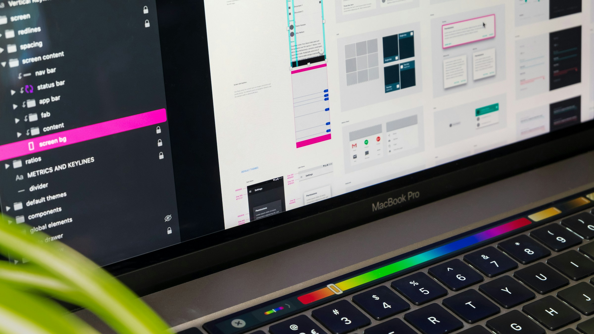

To choose a UX design agency for a B2B SaaS product, look for proof that they have shipped complex software (not only marketing sites), ask them to walk you through how they made decisions on a past project, and run a small paid test on a real problem before you sign anything bigger. Visual polish is the easiest thing to judge and the least useful signal. What you are really buying is judgment about users, data and engineering constraints.

The failure mode is familiar. A founder picks an agency from a few beautiful portfolio shots and a good sales call. The agency delivers clean screens for the happy path. Then engineering opens the files and finds no empty states, no error states, no permission rules and no idea what happens when a table holds ten thousand rows. The product team spends the next quarter designing the hard parts themselves.

## What should a B2B SaaS team look for in a UX design agency?

B2B SaaS users are often experts doing repetitive, high-stakes work, and the product has to make sense to an admin, an analyst and an executive at once. Judge an agency on four things.

### Experience with complex, data-heavy software

Ask to see dashboards, tables, settings, permissions, onboarding for technical users and workflows with many states. If every case study is a landing page or a mobile app with five screens, the team may be talented, but they have not done your kind of work yet.

### Research they actually run

Good agencies talk to users before they draw. Ask what research they would do in the first two weeks, and with whom. For B2B products, that usually means interviews with a handful of real customers, a look at support tickets and session recordings, and time with your sales and success teams. If you want a deeper view of what that should look like, we wrote about [UX research for complex B2B products](/ux-research-for-b2b-saas/).

### Design that engineers can build

Ask how they hand off work. You want components that map to your front end, documented states, and designers who answer questions in your Slack while the feature is built. An agency that knows your stack (React, a component library, a design system in Figma) will save your engineers real time.

### A working rhythm that fits yours

Time zones, tools, meeting cadence and how requests are submitted matter more than most teams expect. A partner that works your hours and lives in your Slack moves faster than one that sends a deck every two weeks.

## What red flags should you watch for?

- **They show only finished screens.** No sketches, no rejected options, no research notes. You cannot judge thinking from final pixels.
- **They promise a full redesign before they have seen your product.** A serious team asks to see the product, the data and the users first.
- **The senior people disappear after the sale.** Ask who will do the work day to day, and meet them.
- **They cannot explain a past result.** If a case study claims an improvement, ask how it was measured and what else changed at the same time.
- **Everything is fixed and nothing is discussed.** B2B products change as you learn. A partner should have a clear way to handle new requests.
- **No questions about your business.** If they never ask about your buyers, business model or churn, they are designing in a vacuum.

## Which portfolio signals separate real product work from polish?

The strongest portfolios read like decision logs. Look for these signals:

1. **A stated problem and a constraint.** "Admins could not tell who had access to billing data" is a real problem. "We modernized the look" is not.
2. **Evidence of research.** Personas, journey maps, interview findings or usability test notes, even in summary.
3. **The unglamorous states.** Empty states, loading, errors, bulk actions, long lists. These are where B2B products succeed or fail.
4. **A system, not a collection of screens.** Components, tokens, documented patterns. That is what lets your team keep shipping after the agency leaves.
5. **Results with context.** A metric is useful only if they can explain how it was measured.

As one example of what this looks like in practice, our [CloudGuardia case study](/work/cloudguardia/) for a cloud security platform covers the research and personas, the design kit and the custom icon set, not only the final screens.

## What questions should you ask on the first call?

Bring a short list and listen for specifics:

- Walk me through a B2B project where the first design direction was wrong. How did you find out, and what changed?
- Who exactly will work on our product, and how senior are they?
- What would you need from us in the first week?
- How do you handle requests that come up mid-project?
- How do you hand off to engineering, and do you stay involved during the build?
- What tools do you design and build with? (A partner should be open about this. Ours is on our [tech stack page](/tech-stack/).)
- How will we know, a month in, whether this is working?

Vague answers to the first question are the clearest warning sign. Every experienced team has been wrong; the good ones can say how they caught it.

## How do you run a paid test before signing a bigger contract?

A short paid test on your real problem tells you more than any pitch.

1. **Pick a contained, real problem.** One flow, such as inviting a teammate, setting up an integration or reading a usage report. Big enough to require thinking, small enough to finish quickly.
2. **Write a one-page brief.** The problem, the users, what exists today, constraints and how you will judge the result. Give every agency the same brief.
3. **Time-box it.** Agree on a fixed scope and a fixed date up front.
4. **Pay for it.** Paid work gets real effort and respects the agency's time. Free spec work tends to produce polished guesses.
5. **Judge the process, not only the output.** Did they ask good questions? Did they challenge your assumptions? Could your engineers build what they delivered? Would you want to work with these people every week?

If you want a lighter first step, a [free UX audit](/free-ux-audit/) is another way to see how a team thinks about your product before any contract. At delbueno™ Studio we also scope fixed-fee Launch Sprints for exactly this kind of contained first project; the models are explained on our [engagements page](/engagements/).

## What is the short version?

Pick the agency whose thinking you trust on your hardest screens, not the one with the shiniest portfolio. If you are weighing whether to build design in-house or bring in a specialized partner for a complex product in Cloud, DevOps, Security, AI or Fintech, [book a call with delbueno™ Studio](/contact/). We will tell you honestly whether we are a fit.

## Frequently asked questions

### How many UX agencies should we talk to before choosing?

Two or three serious candidates is usually enough. More than that turns the process into a beauty contest and delays the work. Spend the time on deeper conversations and a paid test with your top choice or two.

### Should we hire an agency that specializes in our industry?

Industry experience helps, but experience with complex software matters more. A team that has designed security dashboards or DevOps tools will adapt to a fintech workflow faster than a consumer app team will. Ask how they ramp up on a new domain.

### Will a design agency sign an NDA?

Most will sign one on request, and you should ask before you share anything sensitive. delbueno™ Studio signs NDAs on request.

### How quickly should an agency show first designs?

It depends on the scope, but you should not wait weeks for a big reveal. Ask for early concepts and frequent check-ins. At delbueno™ Studio, kickoff happens the same day we agree on scope and first concepts arrive within 48 hours.

*Photos by Kaleidico and Tirza van Dijk on Unsplash.*
