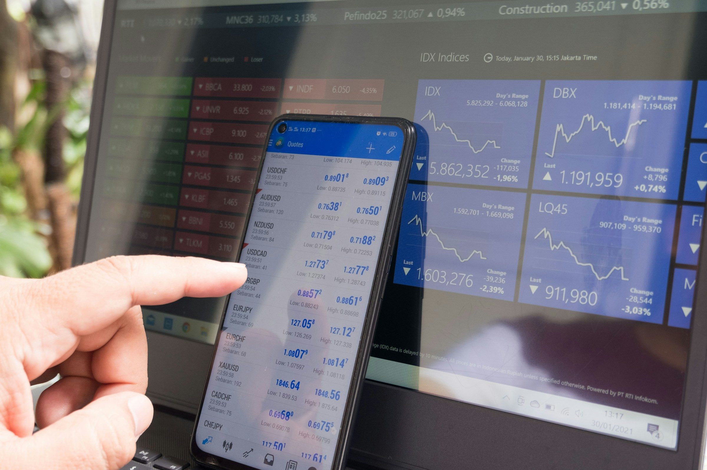

The best UX design agency for a fintech startup is one that has already shipped money movement, verification and financial dashboards, and that fits your stage and budget. For a seed-stage fintech, that usually means a senior product design team that works fast, can sit with your compliance reviews, and has a fintech case study you can open. Agencies worth comparing in 2026 include UXDA, Clay, MetaLab, Ramotion, Fuzzy Math, Eleken and delbueno™ Studio, each best for a different situation.

**Disclosure:** this article is written by delbueno™ Studio, which is one of the agencies on the list. Nobody paid to be included and there are no affiliate links. Every fact about the other agencies comes from their own websites or public profiles, checked in November 2026. If something has changed, tell us and we will correct it.

## Who is this guide for?

Founders, heads of product and engineering leads at fintech startups, from pre-seed to Series A: payments, neobanking, lending, wealth and trading apps, finance tools for businesses, and the infrastructure behind them. You are deciding whether to bring in an outside design partner and want a shortlist you can check.

It is not written for banks running a multi-year digital transformation, though two agencies below do that work. For the wider picture, read our [guide to UX design for startups](/ux-design-for-startups/).

## What makes UX design for fintech startups different?

Three things a fintech design partner should raise on the first call:

1. **Money moves one way.** A transfer, a trade or a closed account often cannot be undone, so confirmations, previews and recovery windows carry real weight. We cover the patterns in [fintech UX for actions users can't undo](/fintech-ux-irreversible-actions/).
2. **Compliance sits inside the product.** Identity checks and disclosures are where new users drop off, so sequencing them is onboarding work (see [SaaS onboarding UX patterns](/saas-onboarding-ux-patterns/)).
3. **Trust is built in the details.** Clear numbers, plain error messages, roles that limit who can move money ([RBAC UX for permissions people understand](/rbac-ux-permissions-design/)) and copy that legal has approved.

## What fintech UX work matters at each stage?

| Stage | Main fintech UX job | Where outside help pays off |
| --- | --- | --- |
| Pre-seed | Prove one money flow people trust | A clickable prototype of the core flow for investor and user tests |
| Seed | Get verified users to their first transaction | Onboarding and verification, transfer and payment flows, the main dashboard |
| Series A | Scale the product and the team | Design system, roles and approvals, reporting for finance teams |

Regulated products take longer to design because legal reviews add rounds. Our answer to [how long it takes to design a SaaS MVP](/how-long-to-design-a-saas-mvp/) explains where that time goes.

## How did we choose the agencies on this list?

An agency made the list only if it met all four criteria:

1. **Product design is a core service**, not an add-on to marketing or development.
2. **Public fintech or financial services work**, shown as case studies or client names on its own site or a reliable source.
3. **It takes startup or scale-up work**, or we say when its typical client is a large institution.
4. **Facts we could verify** on the agency's own site or a public profile.

There is no ranking. Each agency gets a "best for" label based on what it publicly emphasizes.

## Which fintech design agency fits which need?

| Agency | Based in | Best for | Public fintech work, for example |
| --- | --- | --- | --- |
| UXDA | Riga, Latvia | Banks and established financial institutions | Emirates NBD, HSBC, GCash, Finastra |
| Clay | San Francisco, USA | Fintech brand and product from one team | Stripe, Coinbase, Marqeta, Tipalti |
| MetaLab | Victoria and Vancouver, Canada | Well-funded fintechs that want an established product team | Coinbase |
| Ramotion | San Francisco, Los Angeles and New York, USA | Brand-led fintech launches | Stripe, Truebill, Wyre, Puzzle |
| Fuzzy Math | Chicago, USA and Toronto, Canada | Modernizing enterprise financial software | KPMG, Northern Trust, Allstate |
| Eleken | Kyiv, Ukraine | B2B SaaS fintechs that want an embedded designer on a monthly plan | PayUp, Cylynx |
| delbueno™ Studio | Punta del Este, Uruguay (US hours) | Seed-stage fintech MVPs designed and built by one team | Buzz Bunny |

## What is each fintech design agency known for?

### UXDA: best for banks and established financial institutions

UXDA works only in finance and calls itself a "Strategic UX Design Partner for Fintech & Banking Products". Its [site](https://theuxda.com/) lists offices in Riga, New York and London, more than 150 financial service systems designed, and clients in 39 countries. Its case studies list strategic engagements starting at €350,000, so its typical client is a bank rather than a seed-stage startup.

### Clay: best for fintech brand and product from one team

Clay is a branding and UX agency founded in San Francisco. Its [fintech page](https://clay.global/fintech) shows Stripe, Coinbase, Credit Karma, Marqeta, Tipalti and MoneyLion among its clients. A good fit when brand, website and app should come from one team.

### MetaLab: best for well-funded fintechs that want an established product team

MetaLab is an interface design firm founded in 2006 in British Columbia. Its [Wikipedia entry](https://en.wikipedia.org/wiki/MetaLab,_Ltd.) says it works with software businesses in sectors such as fintech and names Coinbase among its clients. See [metalab.com](https://www.metalab.com/).

### Ramotion: best for brand-led fintech launches

Ramotion is a product and brand design agency in San Francisco, Los Angeles and New York. Its [fintech portfolio](https://www.ramotion.com/work/fintech/) includes work for Stripe, Truebill, Wyre and Puzzle, and rapid UI prototyping for Xero.

### Fuzzy Math: best for modernizing enterprise financial software

Fuzzy Math is a Chicago and Toronto UX consultancy, working since 2009 on B2B and enterprise software. Its [financial services page](https://fuzzymath.com/work/fintech-financial-services-ux-design/) names KPMG, Northern Trust, Allstate and Wolters Kluwer CCH.

### Eleken: best for B2B SaaS fintechs that want an embedded designer

Eleken is a UI/UX agency for SaaS products with an office in Kyiv, working on a subscription model. Its [fintech write-up](https://www.eleken.co/blog-posts/fintech-design-agency) describes taking PayUp from an MVP to a scalable product with one design system for web and mobile.

### delbueno™ Studio: best for seed-stage fintech MVPs designed and built by one team

delbueno™ Studio, the author of this article, is a product design and AI development studio in Punta del Este, Uruguay, working in US hours. For [Buzz Bunny](/work/buzz-bunny/), an AI stock recommendation app, we did the research, design system and Flutter build, and onboarding completion rose from 62% to 91% across testing rounds. The team has also worked with BigID, JFrog, NetApp and Palo Alto Networks on dense B2B interfaces. Kickoff happens the same day scope is agreed and first concepts arrive within 48 hours. More on our [fintech UX work](/industries/fintech/).

## How should a fintech startup choose a UX design agency?

1. **Name your riskiest screen.** A first transfer to a new payee, an identity check, a trade confirmation. Ask each agency to show the closest thing it has shipped.
2. **Ask how it works with compliance.** Who writes the copy, how legal comments get folded in, and how decisions are documented.
3. **Check the rhythm.** Time zone overlap, who does the work day to day, and how fast the first milestone lands.
4. **Run a small paid test** on a real flow before signing anything large.

For a broader shortlist of B2B UX design agencies, see [the best UX design agencies for B2B SaaS startups](/best-ux-design-agencies-b2b-saas/). For partners in your time zone, see [the best UX and product design agencies in Latin America](/best-ux-product-design-agencies-latin-america/). Our criteria and red flags are in [how to choose a UX design agency](/how-to-choose-ux-design-agency-saas/).

## What is the next step?

If you are weighing an in-house designer against a specialized partner for a fintech product, [talk to us](/contact/). We will tell you honestly if another agency on this list fits better. If you want an outside view of your current product first, request a [free UX audit](/free-ux-audit/).

## Frequently asked questions

### Do fintech startups need a fintech-specialized design agency?

Not always, but the agency needs to have shipped money movement, verification or financial dashboards before. Ask for a fintech case study you can open, not only logos.

### What should a fintech UX agency deliver for a seed-stage MVP?

The core money flow, onboarding with verification, the main dashboard and every empty, loading and error state, plus a small component library engineers can build from. Brand polish and full design systems can wait.

### Is this list a ranking?

No. Each agency has a "best for" label based on what it publicly emphasizes. delbueno™ Studio, which wrote the article, is one entry among seven.

### Can a design agency work within compliance requirements?

Yes, if compliance joins early. Share your regulatory constraints at kickoff, agree who approves the copy, and ask the agency to document the reasoning behind each verification and confirmation step.

### Will a fintech design agency sign an NDA?

Most do on request. delbueno™ Studio signs NDAs on request, so ask before you share anything sensitive.

*Photos by Atlantic Money and Marga Santoso on Unsplash.*
