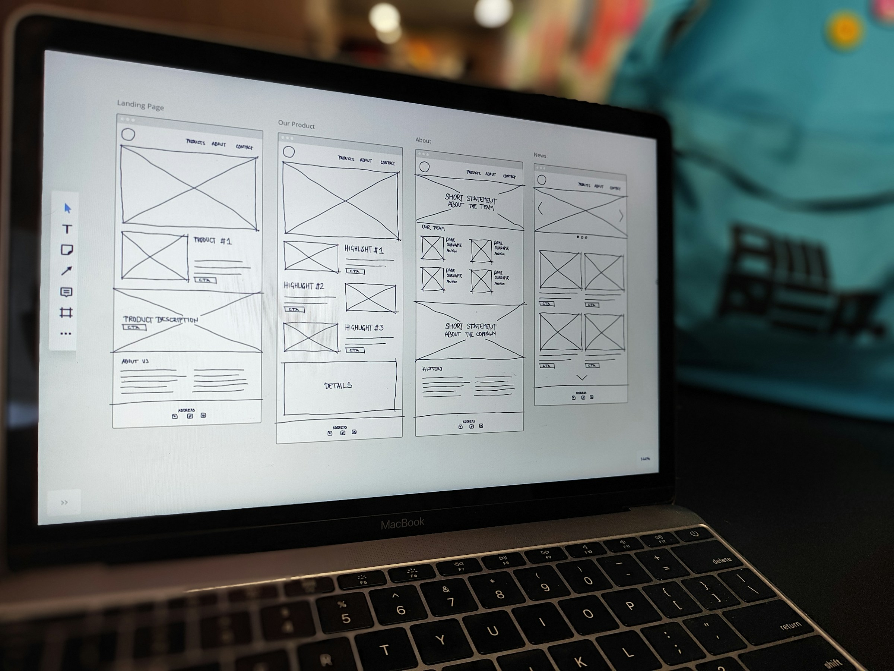

A startup launch website needs a homepage that says what you do and for whom in one sentence, a page that shows how the product works, proof that real people use it, one clear next step (a demo, a trial or a waitlist), and the technical basics that let Google and AI assistants read and quote it. Most launch sites need five to eight pages, not twenty. Build it on a platform your team can edit without a developer, and launch before it feels finished.

The usual failure is not ugly design. It is a polished site that leaves a visitor unsure what the product does after ten seconds of reading.

## Who is this guide for?

Founders and first marketing hires at pre-seed to Series A B2B startups who are launching, relaunching after a pivot, or replacing a site that no longer matches the product behind it. This guide covers the marketing site. For the product itself, read our [UX design for startups guide](/ux-design-for-startups/).

## What should your website do at each stage?

| Stage | The site's main job | What to prioritize |
| --- | --- | --- |
| Pre-launch | Prove interest | One focused page, a waitlist, the founder story |
| Launch | Explain and convert | Product page, proof, pricing or how to buy, a demo flow |
| Growth | Educate and rank | Use case and industry pages, content, comparisons, integrations |

Match the scope to the job. A pre-launch team that builds a growth-stage site spends weeks on pages nobody visits.

## Which pages does a launch website actually need?

- **Homepage:** what it is, who it is for, the outcome, and one call to action.
- **Product or How it works:** real screenshots or a short video of the actual interface.
- **Use cases:** one page per main audience or job, in their own words.
- **Pricing**, or a plain "how to buy" if you sell through sales.
- **About:** the team and why you exist. Buyers and investors both check it.
- **Contact or demo request.**
- **Privacy policy and terms.**

Add a security page if you sell to enterprises, docs if you build for developers, and a blog or changelog once you can keep it updated.

## How do you get the messaging right before the design?

Write the words first. A layout cannot rescue a headline nobody understands.

A homepage headline should answer three questions: what is it, who is it for, and what changes for them. "Usage-based billing for API companies, live in a week" beats "The future of monetization." Pull phrases from sales calls and support tickets, because customers describe the problem better than any internal deck.

Then test it. Show the top of the page to five people from your market for five seconds and ask what the product does. If they cannot say, rewrite before you design anything else. Positioning also gets easier when you name what you replace: spreadsheets, a legacy tool, a hire.

## What are the conversion basics?

- **One primary action per page**, repeated at the top, middle and end.
- **Proof next to the claim:** a quote from a real customer or design partner, logos you have permission to use, or the product itself on screen.
- **Short forms:** ask only for what your next step needs.
- **Show the real product.** For B2B, actual screenshots build more confidence than abstract illustrations.
- **Mobile that works:** plenty of first visits come from a link opened on a phone.

## How do you make a startup website ready for SEO and AI search?

Google and AI assistants such as ChatGPT, Perplexity and Gemini favor pages that answer questions clearly and are easy to parse. The basics:

1. **Clear answers.** Each key page answers its main question in the first paragraph, in words someone would quote.
2. **Structured data.** Mark up your organization, product, articles and FAQs with [schema.org](https://schema.org/) types so machines know what each page is.
3. **llms.txt.** A [proposed standard](https://llmstxt.org/): a Markdown file at your domain root that summarizes your site for language models. Support across AI companies is uneven, so treat it as cheap insurance, not a ranking trick. This site publishes one.
4. **Speed.** Fast pages get crawled, read and shared. Google's [Core Web Vitals](https://web.dev/articles/vitals) are the standard yardstick, and our piece on [page speed and performance](/significance-of-page-speed-and-performance/) explains why it matters.
5. **Crawlable structure.** Clean URLs, a sitemap, one H1 per page, a unique title and meta description for each page, and alt text on images.

Accessibility overlaps with all of this. Semantic headings and good contrast help screen readers and crawlers alike, as we cover in [the essence of web accessibility](/essence-of-web-accessibility/).

## Webflow, Framer or custom code: which should you choose?

| | Webflow | Framer | Custom code (for example Astro or Next.js) |
| --- | --- | --- | --- |
| Best for | Marketing teams that want a mature CMS and fine layout control | Design-led teams that want to move fast with motion | Sites that are part of the product, or need full control |
| Who edits after launch | Marketers, after some training | Designers and marketers, it feels like a design tool | Developers, unless you add a headless CMS |
| Learning curve | Medium, it follows CSS concepts | Low for designers | High for non-developers |
| Content at scale | Strong structured collections | Fine for blogs and simple collections | Whatever you build or plug in |
| Trade-off | Platform rules and plan limits | Less suited to large, complex content models | You maintain everything |

The deciding question is who will change the site every week. If it is marketing, pick the tool they can run alone. Choose custom code when the site is part of the product (docs, interactive demos, pages generated from data) or when speed, security and structured data need full control. This site, for what it is worth, is custom code built on Astro. Our [tech stack](/tech-stack/) lists what we build with.

## What design quality signals build trust?

Visitors judge credibility fast, and B2B buyers look for signs that the company behind the product is real and careful:

- A consistent type scale, spacing and color, so the site looks like one system.
- Real product screens, real team names and real customer words. No stock handshakes.
- No broken links, placeholder text or dead buttons.
- Polished link previews with an Open Graph image.
- A clear privacy policy, and a security page if you sell to IT or security teams.
- Fast load and readable contrast on every device.

## What should you measure from day one?

Install analytics before launch, with a consent banner where the law requires one. Define a handful of events that map to your funnel: primary button clicks, form submissions and sign-ups started. Agree on UTM conventions so campaign traffic stays readable. Verify the site in Google Search Console and Bing Webmaster Tools, submit your sitemap, and watch which queries start bringing people in.

## What belongs on a launch checklist?

- [ ] Homepage passes the five-second test with people from your market
- [ ] Every page has one primary call to action
- [ ] Forms deliver to the right inbox or CRM, tested end to end
- [ ] A unique title and meta description on every page
- [ ] Structured data validated with Google's Rich Results Test
- [ ] Sitemap submitted to Search Console and Bing Webmaster Tools
- [ ] llms.txt published at the root
- [ ] Core Web Vitals pass on mobile
- [ ] Images compressed, with alt text
- [ ] Open Graph image set for link previews
- [ ] Privacy policy and terms live, consent banner where required
- [ ] A useful 404 page, and redirects from any old URLs
- [ ] Analytics events firing
- [ ] Checked on a real phone and a tablet, not only a desktop browser

## What are the most common startup website mistakes?

- A clever headline instead of a clear one.
- Twenty thin pages at launch instead of seven strong ones.
- Hiding pricing or the next step.
- A stack nobody on the team can edit.
- Leaving SEO for later, then losing traffic in a messy migration. If you are replacing a site, read our guide to a [website redesign](/website-redesign/) first.
- Copy that sounds like every competitor's.
- Waiting for perfect.

delbueno™ Studio designs and builds launch websites for B2B startups in Webflow, Framer, WordPress or custom code, with the messaging, launch assets and technical SEO done together. See our [web design service](/services/web-design/). Already live and not sure what is holding the site back? Ask for a [free UX audit](/free-ux-audit/).

## Frequently asked questions

### How many pages does a startup website need at launch?

Usually five to eight: homepage, product, one or two use case pages, pricing or how to buy, about, contact, plus legal pages. Add more when you have something specific to say on each one.

### Should a startup use Webflow or Framer?

Pick Framer if designers will run the site and you want to move fast with motion. Pick Webflow if marketing needs a stronger CMS for lots of structured content. Either works well for a launch site, so let the people who will edit it every week decide.

### What is llms.txt, and do I need it?

It is a proposed standard: a Markdown file at your domain root that summarizes your site and links to its key pages for language models. It is quick to add and does no harm, but AI companies do not all use it yet, so clear answers on your pages still matter more.

### How long does it take to design and build a startup website?

It depends on the number of pages, whether the copy is ready, and how fast feedback comes back. Copy is the most common bottleneck, so write it early. Once the messaging is settled, design and build move quickly.

### Do I need a blog at launch?

No. Launch with the pages that explain and sell the product. Start a blog when you can publish useful answers to your buyers' questions on a steady rhythm, because an abandoned blog hurts credibility more than no blog.

*Photos by Hal Gatewood and Amper on Unsplash.*
