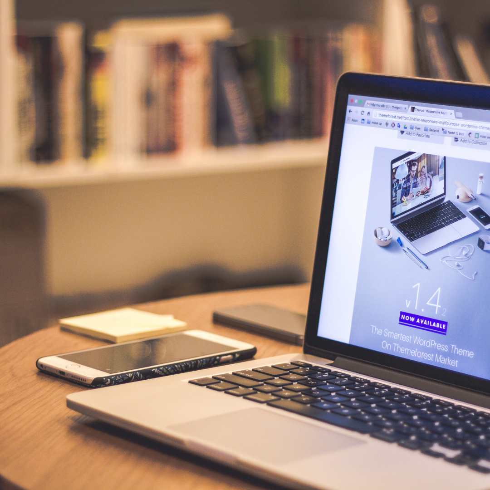

In today’s digital-first world, your website is often the face of your business, the place where most customers will form their first impression of your brand (remember your first impression when you entered [ours](/)?). Whether you’re running a local business in Miami, Florida, or catering to a broader audience across the United States, having a modern, well-designed website can make all the difference. But, let’s be honest: when was the last time you gave your website a fresh look? If it’s been a while, you might be missing out on significant growth opportunities. Let’s dive into why redesigning your website can be a game-changer for your business.

## Why a Website Redesign is Essential for your business

**Creating a Better User Experience (UX)**

Think about the last time you visited a website that was hard to navigate, slow to load, or looked like it was from another decade. Chances are, you didn’t stick around for long. In fact, studies show that 88% of online consumers are less likely to return to a site after a bad experience【[Forbes](https://www.forbes.com/)】. A website redesign focuses on making the user experience smoother, more enjoyable, and more engaging, which is especially important in vibrant markets like Florida and Miami, where businesses are constantly vying for customer attention.

By improving things like navigation, readability, and overall aesthetics, you can keep visitors on your site longer, encourage them to explore more pages, and ultimately guide them toward making a purchase or inquiry. A redesign that puts the user first isn’t just about making things look pretty; it’s about creating a seamless journey that turns curious visitors into loyal customers.

**Boosting Your Visibility with SEO**
Did you know that 93% of all online experiences start with a search engine?【[HubSpot](https://www.hubspot.com/marketing-statistics)】. If your website isn’t optimized for search engines like Google, you could be missing out on a massive chunk of potential traffic. Redesigning your website gives you the perfect opportunity to implement the latest SEO best practices, like mobile optimization, faster loading times, and keyword-rich content.

In highly competitive markets like Miami, where businesses are constantly jostling for visibility, improving your SEO can give you a significant edge. The more visible you are in search engine results, the more organic traffic you’ll attract, and the more opportunities you’ll have to convert visitors into customers.

**Keeping Up with Design Trends and Technology**
Let’s face it: design trends change quickly. What looked cutting-edge five years ago might now seem outdated or clunky. Redesigning your website allows you to stay current with the latest trends and technologies. In the United States, [more than 54% of website traffic comes from mobile devices](https://www.statista.com/statistics/277125/share-of-website-traffic-coming-from-mobile-devices/), so having a mobile-friendly design is no longer optional. It’s essential.

For businesses in Miami, where a significant portion of the population relies on mobile devices, ensuring your website is responsive and visually appealing on all screens is key to capturing and retaining customers. Moreover, integrating new technologies like chatbots, interactive content, and AI-powered personalization can enhance user engagement and provide a more tailored experience, setting you apart from competitors.

**Improving Conversion Rates**
It’s not just about getting people to your website; it’s about what happens once they’re there. A strategically redesigned website can drastically improve conversion rates by removing friction points and guiding visitors toward taking desired actions. For example, businesses in Florida that have invested in conversion-focused website redesigns have reported an average increase in conversion rates of up to 30%【[Crazy Egg](https://www.crazyegg.com/)】.

Whether you’re a Miami-based boutique hotel, a local restaurant, or a digital agency, a website redesign can help you better capture leads, boost sales, or increase bookings by making it easier for visitors to engage with your business.

**Strengthening Your Brand Image and Credibility**
Imagine walking into a store with outdated decor, faded signs, and poorly arranged products. It wouldn’t inspire much confidence, right? The same applies to websites. A fresh, modern design helps establish credibility and trust with potential customers. According to research by Stanford University, 75% of users admit to judging a company’s credibility based on its website design【[Stanford Web Credibility Guidelines](https://credibility.stanford.edu/guidelines/)】.

For businesses in Miami, where the market is highly competitive and dynamic, a professionally redesigned website that reflects your brand’s personality and values can be the difference between standing out and blending in. A great website makes a great first impression, and that first impression is often what determines whether a visitor becomes a customer.

## How a Website Redesign Can Drive Business Growth

1.  **Attracting More Traffic and Generating Leads**
    A well-executed website redesign can significantly increase your site traffic by making it more appealing to both users and search engines. Companies in Miami that have revamped their websites have reported up to a 40% increase in traffic within the first six months【[Neil Patel](https://neilpatel.com/)】. This increased traffic brings more opportunities to convert visitors into customers, especially if your redesign includes strong calls to action and lead capture forms.
2.  **Boosting Customer Retention**
    It’s not just about attracting new customers; it’s also about keeping the ones you already have. A user-friendly, visually appealing website encourages repeat visits and fosters customer loyalty. Companies that have optimized their websites report up to a 20% increase in customer retention rates【[Forbes](https://www.forbes.com/councils/forbestechcouncil/2024/02/28/20-ways-software-development-companies-can-boost-customer-retention/)】. For Miami businesses, where competition is high and customer loyalty is essential, a redesign can be a powerful tool for keeping customers engaged and coming back for more.
3.  **Improving Local SEO for Miami and Florida-Based Businesses**
    Local SEO is crucial for businesses in Miami and across Florida. A website redesign provides the perfect opportunity to incorporate local SEO strategies, such as optimizing for “near me” searches, using localized keywords, and including location-based content. Nearly 46% of all Google searches are seeking local information【[Th](/)[ink with Google](https://business.google.com/en-all/think/)】. By focusing on local SEO, you can attract more local customers who are actively looking for businesses like yours.
4.  **Adapting to Market Changes Faster**
    Markets change, and so do customer needs. A flexible, modern website makes it easier to update content, add new services, and adapt to new trends. In Miami’s fast-paced environment, being able to quickly adjust your website to reflect market changes is a huge advantage. Whether it’s integrating a new e-commerce platform, adding a blog, or launching a new product, a redesign can make your website more adaptable to change.

## To conclude:

A website redesign isn’t just a cosmetic upgrade. It’s a strategic investment that can significantly impact your business growth. From enhancing user experience and boosting SEO to increasing conversion rates and strengthening brand credibility, a redesign offers numerous benefits that can help your business thrive in a competitive market like Miami, Florida, or anywhere in the United States. If you’re looking to grow, now might be the perfect time to give your website the makeover it deserves. Did we mention? We can help you with that! Let’s talk today about how a redesign can boost your business and discuss about the goals you want to achieve with it. If you are a startup launching a first site rather than replacing one, read our guide to [web design for startups](/web-design-for-startups/).
